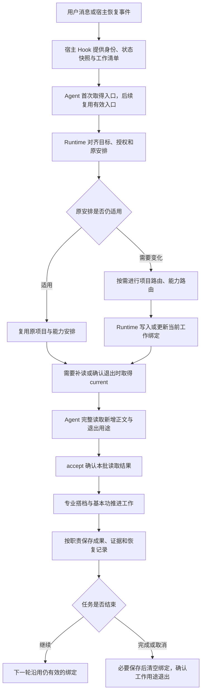

# Runtime 与上下文完整机制

当前机制以**一份当前工作绑定、一份可丢弃的读取缓存、一个公共装配服务**保持工作连续。Runtime 判断当前要做什么、由谁承接；程序根据明确的绑定提供定义与文件；专业能力执行任务并把结果保存到所属领域。

已接入并受宿主信任的 Hook 每轮提供有效清单、补读要求，以及另行接入的聊天状态快照。**完整正文由 Agent 按要求取得、读完并确认；项目成果也由 Agent 按专业方法实际保存。** 这两步都需要执行，不能只看见一条清单就认为已经完成。

本文串起现行机制，说明职责、状态和接口怎样连接。Agent 的执行要求由当前入口、Runtime 和各专业能力定义持有，确定性行为由程序实现；本文不增加业务规则、加载层或授权。各能力的精确版本、来源和可用性以实际定义与读取结果为准，接口参数见[context 契约](../cli/context.md)。

## 1. 整条链路



Hook 安装并获宿主信任后才会自动投递。Hook 提供的是数据；路由、采用、绑定、读取确认和业务动作由 Agent 按当前要求衔接。已有正文完整、安排未变且没有退出要求时，可以直接继续执行。

图中步骤按当前需要进入：方法、事实和工具足够的一次性请求可直接完成；跨轮推进或确定持续使用的能力时才保存绑定。没有Hook时仍可通过本实例入口和current显式取得内容，不把图示当作每轮强制全跑的流水线。

## 2. 几种状态各自负责什么

| 状态或资料 | 回答的问题 | 位置或载体 | 更新者 |
| --- | --- | --- | --- |
| 宿主对话与模型上下文 | 这段对话已经说过、读过什么 | Codex 原生对话、工具结果及压缩摘要 | 宿主管理上下文；Agent追加信息 |
| 当前工作绑定 | 现在做什么、归谁、由谁执行、持续用哪些方法 | `.agents/user-data/chats/<chatId>/shared.json` 中的 `ksf.currentWork` | Runtime 履责的 Agent 调用 bind |
| 正文读取缓存 | 当前代次确认读过哪些内容、上次哪些用途有效 | `.agents/runtime-data/context/<chatId>.json` | accept、SessionStart 换代或显式 reload |
| 聊天参与与动态变量 | 哪个能力在哪轮实际采用过、它的运行变量是什么 | 同一聊天的 `turns.json`、`shared.json` 和 `abilities/` | Hook 登记原生轮次；Agent use、write |
| 项目或领域业务记录 | 已完成什么、证据在哪、下一步如何恢复 | 项目管理主件、任务检查点、成果及各领域原件 | 对应专业能力及程序接口 |
| 对话归档与路由声明 | 用户说了什么、Agent交付什么、各轮上报什么归属和能力 | `档案/对话/Codex/<taskId>/` | 已启用的采集器，结合签名声明归档 |

能力定义、USER/BOT 和对象长期设置提供规则与偏好。对象长期设置通过 `user-data read --object <ID>` 读取，与当前聊天的动态变量分别保存；缺失时不创建默认记录。本次明确要求优先。

上述状态不能互相替代：参与记录不决定当前执行者，读取缓存不保存业务进度，对话归档也不自动成为项目证据或新的执行授权。

## 3. 首次进入时加载什么

### 3.1 入口选择

当前会话首次进入 KSF 时，Agent 按根目录 AGENTS.md 执行：

```sh
.agents/ksf context entry --json
```

程序选择当前入口：需要初始化时进入实例初始化；孵化为 pending 时进入孵化；正常工作进入系统定义的 Runtime。Agent 核对退出码、`ok`、`complete`、`errors`，完整读取返回内容。初始化或孵化优先，旧工作绑定不能绕过它们。

同一会话后续复用仍有效的入口。初始化、孵化和系统维护流程各自规定何时重新取得入口，普通业务步骤不反复检查孵化；根 AGENTS.md 只保留本会话首次加载要求。

常规加载直接完成，反馈围绕用户问题、判断、成果和实质进展。中断事务由固定启动器在加载 Core 前自动恢复；其他故障由 Agent 按需诊断，专业恢复复用现有维护搭档和系统版本维护基本功，根 AGENTS.md 不重复恢复步骤。

### 3.2 正常入口的展开关系

```text
Runtime
├─ # 人设路由
│  ├─ + /USER.md
│  └─ + /BOT.md
├─ 能力路由（无前缀精确依赖，按需读取）
└─ 项目路由（无前缀精确依赖，按需读取）
```

因此正常基础集合是 Runtime、人设路由和 USER/BOT，共四项。能力路由与项目路由的精确依赖继续校验，正文在使用前按需补入。人设路由的维护搭档等未标记引用不会随之全量加载。详细人设在任务确实需要时，由人设管理按明确入口继续读取。

| 内容 | 何时进入模型上下文 |
| --- | --- |
| Runtime、人设路由、USER/BOT | 正常入口首次取得完整原文；当前代次仍有效时复用 |
| 能力路由、项目路由 | Runtime 判断本步需要时，经既有 extras 完整取得后采用 |
| 实际承接能力、持续方法、主项目及指定文件 | 形成当前绑定后，由 current 按绑定与标记展开装配 |
| 兜底搭档、匹配基本功、详细人设及专业资料 | 命中对应需求后按各自方法读取，不加入默认首读集合 |

“固定保护”约束对象来源与修改，不等于正文始终预载。无前缀引用仍参与依赖核验；程序在发现或校验时读取定义，不代表把该正文发送给模型。若首个任务就需要两个路由，同轮仍会补齐它们，基础集合减量不能直接当作整轮总量下降。


| 元数据 references 写法 | 读取父能力正文时的行为 |
| --- | --- |
| `ID@版本` | 保留依赖关系，按需读取正文 |
| `+ID@版本` | 带出目标主文，在这一层停止 |
| `#ID@版本` | 带出目标主文，再按目标内部各引用的标记继续展开 |
| `+./文件.md`、`+/USER.md` | 读取对应文件原文，在这一层停止 |
| `#./文件.md` | 读取文件原文，并按其 frontmatter 中的引用标记继续展开 |

文件相对路径以声明它的定义所在目录解析；以 `/` 开头的是当前 KSF 根目录下的逻辑绝对路径。关联来源中的相对路径保留该来源的边界。YAML 中的 `#` 前缀引用必须加引号。展开按声明顺序深度优先、去重并停止循环，不追踪正文链接和附属资源。

只读元数据、列表、发现摘要时不展开正文。正文读取默认 `all`，`all/body` 才执行标记展开。

标记紧贴引用开头，不属于ID或版本，仅允许一个前缀；普通CLI对象定位仍使用无前缀的ID或ID@版本。展开保留父对象正文，通过可选expanded附带子能力或文件。每项内部继续遵守自己的标记，无标记停止自动加载、+读取本层后停止、#才继续遍历。

例如A引用#B，B引用+C、#D和无标记E，C引用#F，D引用+G：读A时附带B、C、D、G，不带E、F；单独读C才展开F。主文按实际来源、定位、版本及定义摘要去重；先由+读到、后由#遇到的对象，仍继续遍历其内部引用。循环停止重复遍历，失败保留已取得部分和具体错误，不静默截断。

引用与加载不登记采用，不改正式关联，也不执行业务。游离基本功资格仍按有效搭档的正式引用图计算，与是否带加载标记、是否曾被动态使用分开。


## 4. 项目和能力如何被选中

Runtime 先判断本次消息是继续、纠正、临时插问还是独立新目标。追问和局部纠错保留原有有效安排，目标或交付实质变化才重选。

Runtime 在需要确定或切换项目、补项目/工程事实时取得项目路由；需要新选或改用能力时取得能力路由。路由全文及其标记展开内容通过现有 `context current --extras` 作为本步临时支持装配，完整读取后沿同一delivery确认；完整有效原文仍在上下文时直接复用。两者都需要时可以一次装入，先补项目事实再选能力。此处只是现有装配机制的调用，不增加加载层或第二份路由状态。

临时路由用完后退出该用途，持续绑定实际执行者和方法。压缩后恢复当前绑定与四项基础正文；再次需要路由时重新补读。若路由本身仍是跨轮工作的持续方法，沿现有methods绑定恢复，不另存路由阶段字段。

**项目路由**识别主归属、核对根卡、必要事实、工程关系及可选 routing 预设，返回实际入口和缺口。它不写绑定，也不选择最终能力。没有项目的一次性工作可以正常推进。

**能力路由**按以下顺序选择足以承接任务的对象，足够即停止扩大：

1. 明确指定的能力。
2. 仍有效的原安排。
3. 项目预设，复用本轮仍有效的根卡及检查结果。
4. 全局协同。
5. 全局普通搭档。
6. 均未命中时，由基本功路由搭档进行一次游离基本功匹配。
7. 宿主方法足够时由通用 Agent 承接，否则返回具体缺口。

全局发现先提供完整元数据摘要，固定入口从下游承接候选中排除；候选正文用于确认职责和适用条件，实际采用前补齐必要支持。项目路由和能力路由各自返回 Runtime，不互相调用。游离基本功查询实时计算有效引用图，不新增静态关联，也不递归重启路由。

基本功兜底也有明确分工：Runtime交给基本功路由搭档；搭档通过+引用取得游离基本功匹配，匹配方法查询实时候选、核对适用性与最新资格，交回精确定位、选择依据和缺口。搭档将实际采用的方法交回Runtime更新当前安排，再按该方法执行、核验和交付。匹配方法不执行业务或保存工作绑定。本次兜底不递归返回能力路由或再次调用自身；发现不完整、确实无匹配与执行条件不足分别返回。

被审阅或被修改的能力属于工作目标，不因此成为执行者。一个项目可以使用通用 Agent，也可以使用专用搭档；这与项目归属分别判断。

## 5. 当前工作绑定怎么维护

形成稳定承接后，Runtime 把持续安排写入唯一当前绑定。

| 字段 | 含义 |
| --- | --- |
| `goal` | 当前目标 |
| `status` | `active` 或 `paused` |
| `ownership` | 主归属：`bound`、`none` 或 `unresolved`；bound 时附实际目标 |
| `relatedTargets` | 其他相关目标，不自动成为执行能力或加载正文的清单 |
| `executor` | 当前主执行能力；通用 Agent 直接承接时可为 null |
| `methods` | 当前阶段需持续使用的能力方法 |
| `files` | 必要文件的根内路径及用途 |
| `taskRef` | 当前任务恢复记录的本实例内路径；可为 null |

需要可靠接续的非项目工作同样复用已有机制：必要原件由files定位，已有恢复记录可由taskRef接入；外部原件保留实际入口，确需保存由专业能力按授权处理。没有可靠入口时保留具体缺口，不自动建项目，也不能只加载能力正文就声称恢复了工作进展。

绑定只存定位与简短目标，不复制正文或项目计划。executor/methods 使用精确版本和实际来源；能力型主归属及 relatedTargets 在写入时也固定实际版本、来源，保留已有稳定目标身份。

更新过程是读取 `context work` 得到 etag，再提交完整当前值。程序校验结构、来源和版本，以 etag 防止覆盖并发更新。安排变化后，同轮取得新的 `context current`，核对所选执行者及持续方法已进入 active。

候选、仅审阅对象和一次性支持不自动进入持续绑定。临时方法可通过 `current --extras` 提供，下一次省略即退出临时用途。`chat use` 和 `task declare` 都不会替 Runtime 写入工作绑定。

## 6. 每轮怎样补充正文

### 6.1 Hook 先提供清单

UserPromptSubmit 的工作上下文 Hook 提供 `KSF_WORK_CONTEXT_V1`：当前目标、绑定版本、缓存代次、active、pending、retired 和读取要求。聊天状态 Hook 另提供原生轮次、公共变量及能力状态快照；两者用途不同。

`readRequired=false` 表示程序没有发现待补或待确认退出项。Agent 仍须确认当前安排符合新请求、所需原文确实仍在上下文中。若只剩摘要、正文已丢失，就需重新取得原文。

### 6.2 一个服务组装当前集合

```text
当前有效集合
= 当前入口及标记展开的基础内容
+ executor 及其标记展开内容
+ methods 及其标记展开内容
+ 主归属为项目时的项目根卡
+ files 中明确列出的文件
+ taskRef 指向的任务记录
+ 本次 extras 临时支持
```

程序会核实其他相关目标，但不会因此读取所有相关项目、全部能力或全部资料。项目管理主件、详细证据和正文链接仍按专业方法渐进取得；需要跨轮稳定装配的必要文件才进入 files。

### 6.3 比较指纹，返回增量

| 返回项 | 意义 |
| --- | --- |
| `active` | 本次有效的完整清单，每项带用途 |
| `pending` | 当前代次尚未确认读过、且原文存在的内容 |
| `bodies` | 本批待补的完整主文或文件原文 |
| `retired` | 相较上次已确认清单，退出的内容用途 |
| `delivery` | 供完整读取后确认的本批凭据 |

能力指纹包含来源、定位、版本和定义摘要；文件指纹包含来源、路径、内容摘要及状态。同一定位与内容合并多个用途；内容变化时提供该项完整新正文，不对正文做行级差异补丁。

Agent 读完清单、所有 bodies 及退出要求后，将原样 delivery 提交 accept。程序重新核对绑定、缓存代次、清单摘要和版本，成功后更新 active 与 seen。若输出截断、内容变化或确认失败，就补读或重新取得本批，不能确认残缺内容。

accept 记录的是“Agent 声明确认已读取”。程序无法证明模型理解了正文，也无法保证宿主永远保留它。未确认内容可以再次提供，因此一次工具输出成功不能代替消费确认。

## 7. 切换、暂停、结束和压缩

| 情形 | 绑定处理 | 上下文处理 | 业务记录处理 |
| --- | --- | --- | --- |
| 原任务继续 | 复用有效安排 | 只补新增或变化内容 | 有实质进展时按专业方法保存 |
| 同项目换能力或阶段方法 | 更新 executor/methods，保留仍需要的项 | 新能力补全文；旧用途退出；共同方法复用 | 保留成果、决定和授权，更新受影响的恢复信息 |
| 临时插问或支持 | 不必改主绑定，可用 extras | 加入临时用途，下次省略退出 | 不自动升级成长期项目安排 |
| 切换主项目 | 重新确定主归属及能力安排 | 退出旧项目用途，补新项目所需内容 | 保存旧工作的必要恢复点；建议在目标项目新开聊天，创建仍需用户指令 |
| 暂停 | 保留绑定，设 paused | 当前实现仍可装配暂停工作的内容；是否执行由 Runtime 遵守暂停要求 | 保存事实、未决和恢复条件 |
| 恢复暂停工作 | 核对最新请求后设 active 或调整安排 | 补足变化内容 | 复核过期事实及原操作结果，再继续 |
| 完成或取消 | 必要保存后提交 null 清空 | 基础集合保留，工作用途退出并确认 | 保留成果、证据及完成/取消结论 |
| 同一聊天压缩或恢复 | 保留当前绑定 | SessionStart 换代，重新补读当前集合 | 继续从指定恢复记录核对业务事实 |
| 新聊天或分叉聊天 | 使用独立 chatId，不自动复制父聊天绑定 | 独立缓存与读取确认 | 明确继续哪个任务后读取相应原件 |

绑定本身只有 active、paused 或不存在。完成、取消、阻塞及验收结论分别由任务或业务记录表达；`paused` 也不是程序执行锁。

**退出声明不会物理删除宿主历史。** 它告诉 Agent 哪些旧能力职责或资料用途已不适用于当前工作；已有事实、成果和用户决定按其来源继续保留。同一内容仍有其他有效用途时继续生效。

同一缓存代次内，先用 A、换 B、再回 A，可以复用已确认的 A；前提是全文仍完整可用。自然压缩后，受信任的 SessionStart Hook 会清空读取缓存并生成新 generation，下一次按当前绑定重读。它不会根据参与历史恢复已经退出的 A 或临时方法。

SessionStart 对 startup、resume、clear、compact、fork 事件换代。Hook 缺失、连续性不明或需要完整重读时，允许写入的任务可显式 `context current --reload --json`。同一聊天的绑定保留，读取缓存重建，原生轮次与能力参与次数不会由此新增。

## 8. 工作成果和证据怎样进入项目

绑定到 `示例项目` 后，装配服务会提供项目根卡；持续执行所需任务记录或其他文件通过 taskRef/files 明确接入。专业能力据此取得本次工作的位置、约定和必要原文。

实际保存遵循专业职责：

| 事项 | 责任归属 |
| --- | --- |
| 目标、授权、当前承接与工作绑定 | Runtime |
| 能力定义、生命周期和配置 | `partner.ksf.ability-manager` 及相应基本功 |
| 项目计划、推进、检查点和验收 | `partner.ksf.project-manager` 及规划、推进控制、验收基本功 |
| 知识整理 | `partner.ksf.knowledge-manager` 及知识方法 |
| 正式资料原件、版本及调阅 | `partner.ksf.archive-manager` 及档案方法 |
| 收件箱分流与承接 | `partner.ksf.inbox-manager` 及收件箱方法 |
| USER/BOT 维护及深层人设 | `partner.ksf.persona-manager` 及人设方法 |

例如开发任务的测试回执、产物和报告保存到 `项目/示例项目/资料/<本次任务>/` 或任务约定的工程位置；持续任务的恢复信息保存在 `项目/示例项目/任务/<任务名>.md`。根卡保留入口，现行目标、阶段和承诺由已经采用的项目管理主件持有。

**绑定解决“按哪个项目和能力工作”，专业方法解决“具体保存什么、何时保存、保存在哪里”。** Agent 必须实际写入并核对原件、链接及回执。装配服务不会监听每次工具执行、自动把结果写进项目；对话归档也不会自动复制成正式测试证据。

项目进度不写入读取缓存，对象长期设置不保存项目计划。普通局部工作沿专业承接推进，不要求每次经过全项目规划或另一个通用维护角色。

## 9. 动态变量、参与记录和对话归档怎样衔接

实际采用能力前，Agent 读取该对象长期设置，并在允许写入时用原生 turnId 调用 chat use；同一能力同一运行的同一原生轮次只计一次。读取候选、看见 Hook 注入或取得能力正文，都不会自动登记采用。

能力需要维护自己的聊天运行变量时，Agent 在该能力空间中显式 write，带最新 etag。公共变量使用 shared 空间；`ksf.currentWork` 复用该空间保存，但由 bind 按自己的结构管理。变量字段由实际能力决定，程序不从能力正文自动生成字段或推进业务状态。

自动聊天状态快照有大小和数量上限，省略项会用完整性字段说明；省略不等于变量缺失，需要时按对象 ID 补读。它默认提供最近一次明确参与的能力状态，当前工作集合仍以工作绑定为准。压缩、同轮工具问答和读取正文不会自行增加原生轮次。

在已经接入对话采集的范围内，开始工作、安排变化和交付前，Agent 用 task declare 上报当前归属、采用对象和状态，取得只读签名回执。采集器在既有启用范围内归档用户消息、可见过程说明、最终答复及有效声明。正文采集、能力参与、当前绑定和项目保存是四种独立动作。

采集策略与业务文件写入分开：普通讨论使用capture，明确仅本轮不记录使用exclude，持续不记录对话使用pause，明确恢复使用resume。task declare只读核验并返回签名回执，实际归档由采集器执行；没有路由报告时可采集普通对话，但不能推断归属和采用能力。未接入该采集方式的宿主沿已有route机制上报，具体范围见[采集说明](task-capture.md)及[task接口](../cli/task.md)。

因此，一轮声明 completed 不会自动清空工作绑定、完成项目事项或产生验收结论；本轮用过的能力也不会自动成为下轮执行者。当前执行集合看绑定，参与历史看账本，结果看对应原件。

## 10. 异常和只读任务

| 情况 | 当前处理 |
| --- | --- |
| 中断的系统事务 | 固定启动器在加载 Core 前自动恢复；遇到活动事务、恢复冲突等情况保留现场，按现有维护方法诊断 |
| 文件 missing | 明确返回缺失状态及 null 原文，不创建默认文件；Agent判断是否影响任务 |
| 不可读、编码错误、版本不符、归档能力或来源歧义 | 保留具体错误和可得部分，不冒充完整交付，不自动换源或版本 |
| 绑定损坏 | 保留业务状态并报告，不能当作无任务 |
| 读取缓存损坏或丢失 | 可重建；重新补读当前内容 |
| etag 冲突或迟到确认 | 重新读取最新状态，拒绝覆盖或确认旧的一批 |
| Hook 清单超过 6000 字节 | 明示容量错误及补读要求，显式取得完整清单 |
| 禁止 Agent 写入 | 跳过 bind、accept、reload/reset、use、变量修改及 Hook 安装；临时读取原文并说明未持久确认 |
| 缓存称已读，但正文已经不在上下文 | 允许写入时可 reload；禁写时按精确清单直接读原件 |

只读要求约束 Agent 的操作。已经安装的宿主 Hook、原生记录和既有对话采集有各自生命周期与采集策略；“只读业务文件”不等于关闭所有宿主记录。用户要求暂停 KSF 对话采集时，使用独立的采集策略处理。

## 11. 一个完整例子

以同一个开发项目的两个阶段为例：

1. **开始设计。** Runtime 选 A 搭档，持续方法为 M，项目为 P；保存绑定并取得 A、M、P 根卡及必要任务原文。完整读取后确认。
2. **下一轮继续。** Hook 提供仍有效的清单；正文和安排未变时直接复用。能力实际使用按新原生轮次登记，读取缓存不因此失效。
3. **转入另一专业阶段。** Runtime 把 executor 从 A 改成 B，M 继续保留；补读 B，退出 A 的 executor 用途，不重复发送 M。
4. **临时检查 X。** 本次通过 extras 取得 X，不改变 B/M 主绑定；下一次省略 X，确认临时用途退出。
5. **发生原生压缩。** Hook 更换缓存代次；当前绑定仍为 B/M/P。重新读取 B、M、P 及必要文件，不从历史参与台账拉回 A、X。
6. **执行并保存。** 专业能力把产物和证据写到 P 的约定位置，持续恢复细节写入指定任务记录，核对保存结果。
7. **完成。** 必要结果保存后清空绑定，确认工作用途退出。历史成果原位保留，下一轮从基础集合和用户新请求开始。

这个例子说明各步的职责与数据关系，不是固定顺序的程序调度图。已有安排足够时复用；程序回归、当前 Agent 走查、真实宿主事件和独立模型效果分别验证，不能互相代替。

## 12. 接口和实现入口

命令使用当前 KSF 根的固定启动器；跨目录用绝对路径，Windows 使用 `.agents/ksf.ps1`。以下读取命令可用于核对现状：

```sh
.agents/ksf context work --json
.agents/ksf context current --manifest --json
.agents/ksf context current --json
.agents/ksf chat context --json
```

bind、accept、reload 和临时 extras 的完整契约见[上下文接口](../cli/context.md)。SDK 的 `createWorkContextClient` 提供 read、bind、current、accept、reset，显式传原生会话身份，与 CLI、Hook 共用同一服务；SDK 也需要调用方完整消费后再确认。

| 规则或实现 | 入口 |
| --- | --- |
| 固定入口 | [AGENTS.md](../../../../AGENTS.md) |
| Runtime 职责与业务衔接 | [Runtime 定义](../../abilities/partners/ksf-runtime/partner.md) |
| 三个渐进路由 | [人设](../../abilities/competencies/persona-route/competency.md)、[能力](../../abilities/competencies/ability-route/competency.md)、[项目](../../abilities/competencies/project-route/competency.md) |
| 入口选择与基础展开 | [入口服务](../../runtime/src/services/entry-context.js)、[协作上下文](../../runtime/src/services/collaboration-context.js) |
| 引用解析和展开 | [引用格式](../../runtime/src/objects/schema.js)、[展开服务](../../runtime/src/objects/expansion.js)、[文件定位](../../runtime/src/objects/file-locations.js) |
| 工作绑定、装配与消费确认 | [work-context 服务](../../runtime/src/services/work-context.js) |
| 自动工作清单与恢复换代 | [context Hook](../../runtime/src/services/context-hook.js) |
| 应用调用 | [SDK context](../../applications/sdk/src/context.ts) |
| 聊天轮次、参与及变量 | [chat 接口](../cli/chat.md) |
| 对话归档及签名声明 | [task 接口](../cli/task.md) |
| 项目检查点和恢复方法 | [项目推进控制](../../abilities/competencies/project-control/competency.md) |

## 13. 验证这条链路

| 关注点 | 核对内容 |
| --- | --- |
| 入口与依赖 | 正常入口完整返回Runtime与四项基础集合；初始化/孵化不混入旧工作；缺失、版本不符、来源冲突保持错误 |
| 按需触发 | 普通一次性请求不扩大路由；需要项目事实或新能力时，先读对应路由全文及标记展开，再依其方法判断；已有安排有效时复用 |
| 增量与退出 | 单项新增只补该项，确认后重复零正文；省略extras只退出临时用途；相同内容仍被其他用途需要时保留 |
| 切换与恢复 | 替换受影响能力而保留共同方法；换代后只恢复当前绑定；已结束路由不回流，仍为持续方法的路由随绑定恢复 |
| 消费与并发 | 截断或错误不确认，绑定/内容/缓存变化拒绝迟到delivery；只读操作不改变绑定、缓存或参与 |
| 专业保存 | 产物、证据与恢复入口实际存在，归属及授权正确；绑定、参与、采集和项目进度互不代替 |

现有自动化入口包括[minimal-runtime.test.js](../../runtime/tests/minimal-runtime.test.js)、[runtime-management-refactor.test.js](../../runtime/tests/runtime-management-refactor.test.js)、[work-context.test.js](../../runtime/tests/work-context.test.js)与[context.test.js](../../runtime/tests/context.test.js)。程序测试覆盖结构、装配与接口，语义路由触发和实际效果需要Agent或真实任务验证。隔离compact Hook、显式CLI重载、宿主真实原生压缩分别记录，不把其中一种称作另一种。
