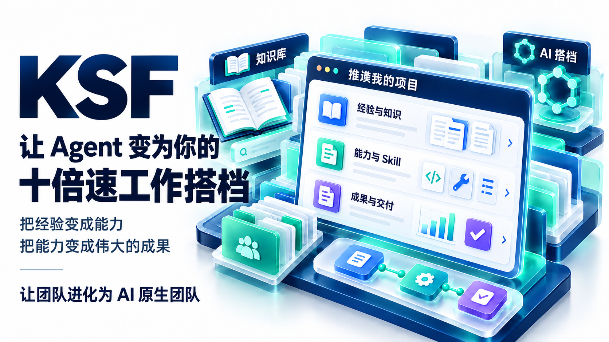
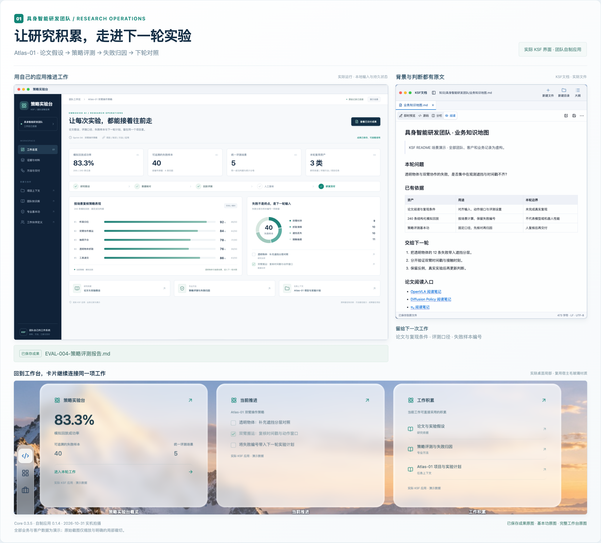
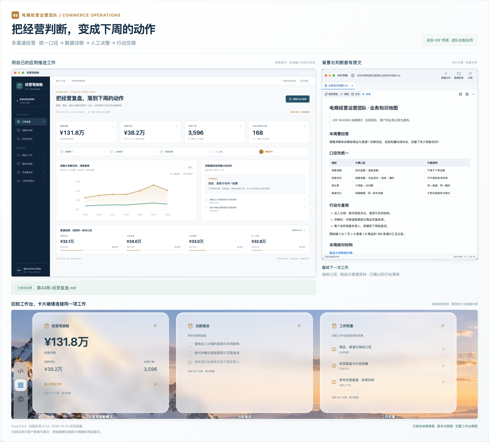
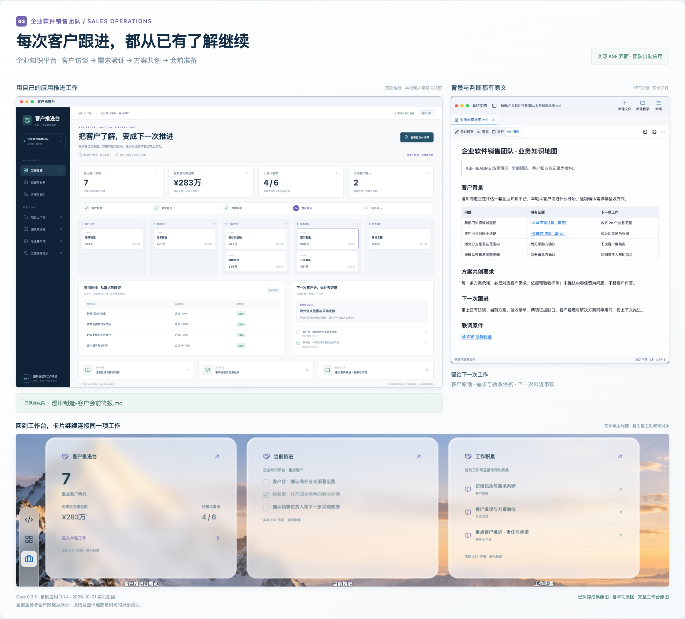
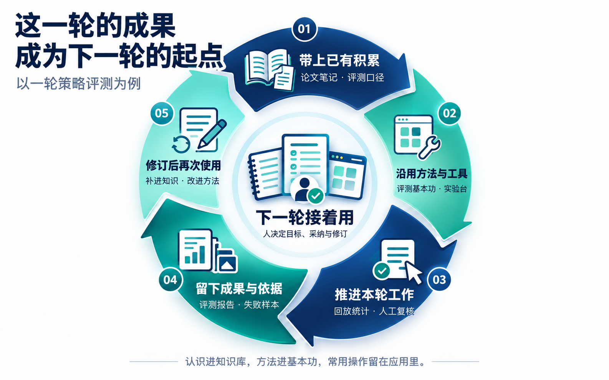
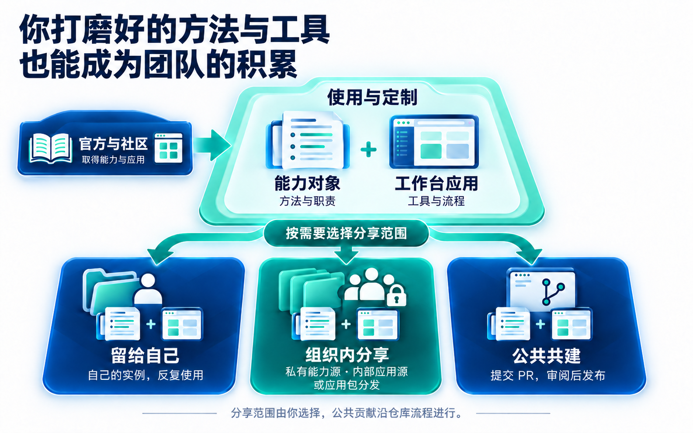

# KSF Core

**让 Agent 变为你的十倍速工作搭档。**

把经验变成能力，把能力变成伟大的成果，让团队进化为 AI 原生团队。



*产品能力概览（示意）。下方提供真实界面与完整上手步骤。*

[创建自己的 KSF](https://github.com/yinbaiyuan/ksf-workspace) · [开始使用](#从模板开始使用) · [看团队场景](#用-ksf-完成你的工作) · [使用手册](.agents/core/docs/README.md)

KSF 是面向个人与团队的 AI 工作框架，**既是知识库框架，也是工作流框架**。它把背景资料、专业方法、AI 搭档、应用和协作流程组织在同一个工作空间。你继续用 Codex、WorkBuddy 等 Agent 客户端工作；KSF 为任务组织可读取的背景、可采用的方法，以及可运行的工具。

KSF 是 **Knowledge · Skills · Flywheel（知识、技能、飞轮）** 的缩写，也代表 **Key Success Factors（关键成功要素）**。知识提供依据，技能保留方法，工作中的结果与修订推动下一轮改进。

## 用 KSF 完成你的工作

从研发、经营到销售，KSF 把背景、方法、工具和交付接在一起。下面是三支团队的实机演示：专用应用用 KSF SDK 实际制作并安装，资料、客户与业务数字均为演示内容。

### 具身智能研发团队：让每次实验都能接着往前走

**任务：定位双臂操作策略的失败原因，形成下一轮实验计划。**

- **带着研究依据开始。** 论文笔记、复现条件和历史失败留在知识库，Agent 沿项目找到本轮假设，采用策略评测基本功，明确输入与成功判据。
- **把评测做成自己的工具。** 策略实验台读取 240 条模拟回放，按场景统计并保留失败编号；桌面卡片直接查看结果、待办和相关材料。
- **交付能继续验证的结论。** 人复核后生成报告，失败样本、口径与下一轮对照计划一同留在项目中。团队下次从这些积累继续，而不是重新整理背景。



*Core 0.3.5 实机 · 策略实验台为团队自制演示应用。回放数据为模拟记录，不代表真实模型或机器人性能。*

### 电商经营运营团队：把经营复盘落到下周的动作

**任务：复盘多渠道经营，判断哪里值得继续投入、哪里需要先查清原因。**

- **先统一判断依据。** 商品、渠道、投放与退款资料进入项目，指标口径留在知识库。Agent 采用经营复盘方法，按同一期间和成本范围组织分析。
- **从数字找到具体问题。** 经营驾驶舱读取 7 天、4 个渠道、6 个商品的 168 条记录，计算销售净额与贡献毛利。对照渠道差异，回到商品页面、退款原因和投放记录核实假设。
- **把复盘交给下周。** 人确认后生成周报，留下行动、负责人和检查项；有效的分析方法可以复用，新的经营数据继续进入同一套工作。



*Core 0.3.5 实机 · 经营驾驶舱为团队自制演示应用，读取本地演示数据；贡献毛利按图中口径计算。*

### 企业软件销售团队：把客户了解变成下一次推进

**任务：为“澄川制造”准备企业知识平台方案与下一次客户会。**

- **先读懂这位客户。** 访谈、会议原件和产品资料留在知识库，客户目标、当前阶段与责任留在项目。Agent 回看客户说过什么，区分已确认需求和内部假设。
- **让方案与证据对应。** 客户推进台把商机阶段、需求依据、验收要求和待确认问题放在一起。客户经理与解决方案同事围绕同一份上下文推进，避免承诺与客户实际需求脱节。
- **每次跟进都有下一步。** 生成会前简报，带上现有判断、证据缺口和跟进事项；会后更新客户确认与方案。客户发现、方案验证等方法留给团队反复使用。



*Core 0.3.5 实机 · 客户推进台为团队自制演示应用。客户、访谈和商机金额均为虚构；生成简报不会改变商机阶段。*

[查看场景原图与演示说明](.agents/core/docs/showcase.md)。这些专用应用展示按工作定制的方式；知识、能力、项目与成果都保存在 KSF 中，可以继续修订、复用和分享。

## 从模板开始使用

从一项真实任务开始，再开一轮对话继续它，就能检查 KSF 是否接住了你的工作。

需要 GitHub 账户、本机 Git，以及已安装并登录的 Codex、WorkBuddy 等支持本地文件与终端工具的 Agent 客户端。当前 `main` 模板面向 **macOS ARM64**；其他平台以 [Releases](https://github.com/yinbaiyuan/ksf-core/releases) 实际提供的匹配包为准。

### 1. 从 ksf-workspace 创建自己的仓库

打开 [ksf-workspace](https://github.com/yinbaiyuan/ksf-workspace)，点击 **Use this template → Create a new repository**，选择自己的账户，仓库名可填 `ksf`，可见性选择 **Private**，然后创建。这个仓库保存你自己的知识、项目与能力。

### 2. 克隆到本地

复制新仓库的克隆地址，在希望存放 KSF 的目录执行。将 `YOUR-NAME` 换成自己的 GitHub 用户名；仓库名也按实际替换：

```sh
git clone https://github.com/YOUR-NAME/ksf.git
cd ksf
```

私有仓库需要 GitHub 访问授权，也可以在 GitHub Desktop 登录后克隆。

也可直接[下载工作区](https://github.com/yinbaiyuan/ksf-core/releases)：解压 `ksf-workspace-<版本>-<平台>.tar.gz` 即可按文件夹使用。完整包自带运行时，普通使用无需另装 Node.js、Python 或 npm；文件夹方式无需 Git。

### 3. 用 Codex 或 WorkBuddy 打开根目录

- **Codex**：打开克隆得到的 `ksf` 文件夹，作为本地项目开始新对话，执行位置选择本机（This computer）。
- **WorkBuddy**：新建任务，在发送前把工作目录选为这个 `ksf` 文件夹，使用默认 Agent 模式。

选择 KSF 根目录（包含 `AGENTS.md` 的文件夹），发送任意消息即可开始首次孵化，例如：

> 开始孵化

按客户端提示允许所需的本地文件与命令操作。目录选择方式可参考 [Codex 本地执行说明](https://learn.chatgpt.com/docs/environments/modes)和 [WorkBuddy 工作空间说明](https://www.workbuddy.cn/docs/workbuddy/From-Beginner-to-Expert-Guide/Function-Description/Task-Bar)。执行任务所用的模型、工具与权限由客户端及已配置服务提供。

### 4. 完成首次孵化，打开工作台

Agent 会引导确认四项：**你的称呼、实例名称、局域网本机名、登录后启动后台**。实例名称也是协作伙伴的默认名字，可以一次回答：

> 叫我小林，你叫灵台，其余默认。

接受默认时，本机显示名自动生成，登录启动默认开启。你也可以明确关闭，或说“暂停”“跳过”。正常完成后默认打开一次工作台，再继续原先提出的任务。

以后可直接让 Agent“打开工作台”，或在实例根目录执行：

macOS：

```sh
./.agents/ksf open --json
```

Windows PowerShell（取得匹配的 Windows 工作区包后）：

```powershell
powershell.exe -NoProfile -ExecutionPolicy Bypass -File .agents/ksf.ps1 open --json
```

工作台左上角 **KSF → 系统设置 → 快速上手** 可查看引导与当前状态。

### 5. 做完一项任务，再接着做

把材料放入实例或提供给 Agent，提出具体请求，例如：

> 建立“方案选型”项目。基于这些资料做一份方案对比，保存结论和依据，并留下下次继续的入口。

完成后，在同一 KSF 目录开始新对话，直接发送：

> 继续“方案选型”项目。先找到已有结论和依据，说明下一步该做什么。

检查能否找到产物、依据和下一步，确认这些积累确实能被接着使用。应用需要调用 AI 时，再到系统设置配置“AI 任务服务”。详见[首次使用](.agents/core/docs/handbook/getting-started.md)。

## 日常沉淀：能力对象与工作台应用

**能力对象让方法可以复用，工作台应用让工具可以复用。** 两者都是日常工作的核心积累。

### 能力对象：把有效做法写清楚

| 类型 | 留下什么 |
| --- | --- |
| 协同 Cooperation | 多项责任怎样分工、依赖、交接、返工和验收 |
| 搭档 Partner | 一类工作由谁承担、怎样协作、交付什么 |
| 基本功 Competency | 一项专业工作怎样分析、操作和检查 |
| 数据包 DataPackage | 一组资料的来源、用途与读取条件 |

策略评测、经营复盘、客户发现都可以形成基本功；负责研究、运营或销售的角色可以定义为搭档，跨角色交接可以组织为协同。

能力以文件保存，可以阅读、修改、管理版本和跨项目复用。官方提供入口、路由、对象设计等基础能力；个人和团队也可创建自己的专业能力，或关联已有能力源。搭档是供宿主 Agent 采用的工作定义，实际启动几个 Agent 由宿主与本次执行安排决定。

### 工作台应用：把常用操作做成工具

应用按需提供窗口、桌面卡片、后台任务，以及供 Agent 调用的 CLI，有独立的业务数据、设置和版本。

KSF项目连接项目事实与任务入口，KSF文档浏览和编辑原文，KSF仓库管理工程协作，KSF飞轮回顾工作并保留原始对话。你也可以像上述团队一样，用 SDK 开发策略实验台、经营驾驶舱、客户推进台等专用应用，通过应用商店或应用包供他人使用。

能力对象已经可以使用；“KSF知识”和“KSF能力”图形应用目前为占位窗口。

## 协作飞轮怎样运转



*示意图：已有积累投入工作，结果经过人的复盘与修订，再用于下一轮。*

一轮评测交付后，新的认识补进知识库，方法修订进入基本功，重复操作留在应用里。下一轮实验带着这些积累继续验证。你决定留下什么、采纳什么、怎样修订；Agent 负责理解、判断和推进，程序负责确定性执行与校验。

**做过的工作，成为下一次工作的起点。**

KSF 用“立”字概括支撑这套协作的五个部分：

| 组成 | 回答的问题 |
| --- | --- |
| 系统支持 | 怎样运行、配置、保护资产与恢复工作？ |
| 认知与资产 | 已知什么、依据在哪、正在做什么、留下什么？ |
| AI 能力 | 哪些职责和方法可以复用与改进？ |
| 交互与执行 | 怎样把意图推进到可检查的结果？ |
| 人机共同体 | 人与 AI 如何作为整体参与合作？ |

## 定制与分享



*示意图：个人积累、组织分享与公共贡献是可选择的范围。*

从官方能力与应用开始，按工作需要定制。你可以把成果留在个人实例，也可以只在组织内部沉淀和分享，让同事采用同一套方法、流程和工具；愿意公开贡献时，再通过 PR 参与公共共建。

| 想分享什么 | 使用什么渠道 | 公共贡献入口 |
| --- | --- | --- |
| 能力对象与附属资料 | Git 能力源，可公开或私有，关联后按需读取 | 对应能力源仓库；系统基础能力改进进入 Core |
| 工作台应用 | 应用源索引与安装包，也可内部发包；源码在所属工程维护 | 按 [ksf-apps 贡献说明](https://github.com/yinbaiyuan/ksf-apps/blob/main/CONTRIBUTING.md)提交安装包、索引和源码版本入口 |

组织内分享的访问范围由仓库与分发渠道管理。一次改好的方法、一个常用的小工具，都可以成为团队下一次工作的起点。

## 进一步阅读与参与

- [能力设计与使用](.agents/core/docs/handbook/abilities.md) · [能力源与团队分享](.agents/core/docs/sources.md)
- [应用开发手册](.agents/core/docs/app-development/README.md) · [应用打包与分发](.agents/core/docs/app-development/release.md)
- [完整使用手册](.agents/core/docs/README.md) · [问题反馈](https://github.com/yinbaiyuan/ksf-core/issues) · [系统贡献流程](.agents/core/docs/cli/contribute.md)

`ksf-core` 维护系统、程序、内置应用、基础能力和文档。[ksf-workspace](https://github.com/yinbaiyuan/ksf-workspace) 是由 Core 生成的用户模板；从模板建立的个人实例保存自己的知识、项目、能力与档案，系统升级保留这些用户内容。

## 参与 Core 开发

源码、用户实例和生成模板分别管理；工程边界见 [Git 协作规则](.agents/core/docs/git.md)。本地、CI 与发行遵循[统一测试规范](.agents/core/docs/testing.md)，默认 `ksf test` 执行快速验证，全量显式使用 `--suite full`；精确参数见 [test 命令](.agents/core/docs/cli/test.md)。

```sh
.agents/ksf test --suite quick
.agents/ksf test --changed --plan --json
```
